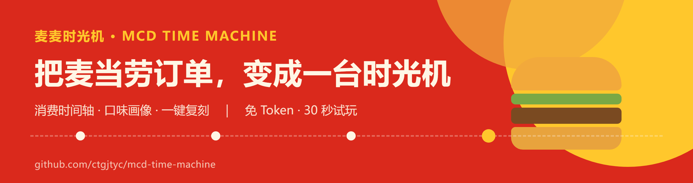

<div align="center">

</div>

# 🍟 麦麦时光机 · MCD Time Machine

> **把麦当劳历史订单，变成一条可以回溯的时间线。**
>
> 输入「2025 年 11 月那顿我吃了啥」，输出那一单的完整清单和复刻方案。
> 输入「我是怎样的麦麦用户」，输出你的口味画像和消费时间轴。

基于[麦当劳中国官方 MCP 服务](https://github.com/M-China/mcd-mcp-server) 开发的参赛 Skill —— **2026 麦当劳程序员创意开发大赛**。

    

---

## 为什么是「回溯」而不是「推荐」

麦当劳 MCP 提供了 35 个工具，绝大多数人拿它做的是**向前看**的推荐与省钱——
「帮你凑单最省」「帮你算热量」「帮你领券」。

但 MCP 里其实躺着两个很少被用起来的工具：`order-list` 和 `query-order`。
它们能拿到你**过去的每一单**，却只回答「查得到」，不回答「这说明什么」。

**这个 Skill 做的事是把订单流水翻译成人话。**

| 你说 | 它做|
|---|---|
| 看看我的麦麦时间轴 | 按月/ 渠道 / 门店 / 时段切片，算出深夜单占比、最长空窗期、最常去的那家店 |
| 我是什么风格的麦麦用户 | 一句话结论 + 画像标签（深夜食客 / 套餐信徒 / 回头客 / 干饭结构） |
| 把去年那顿再来一次 | 定位那一单的完整清单，标注哪些可能已下架、哪些套餐还能换|
| 我多久没吃麦当劳了 | 空窗天数 + 最后一单时间 |

## 30 秒试玩（不需要 MCP Token）

Clone 下来直接跑，所见即接入真实 MCP 后的效果：

```bash
git clone <this-repo> && cd mcd-time-machine
python scripts/demo.py
```

```
🍟  麦麦时光机 · 离线演示（样例数据，非真实用户订单）
──────────────────────────────────────────────────────────
📅  订单时间轴
共 5 单 · 2026-03-02 19:12 → 2026-10-08 08:30 · 跨度 219 天

按月：
  2026-03  ██████████████████ 1 单¥84.00
  2026-04  ██████████████████ 1 单  ¥56.00
  ...
时段画像：深夜单 2 · 早餐单 1 · 最长空窗 107 天

🍟  口味画像
  5 单、290 元、平均 58.0 元/单，最常点「巨无霸套餐」

  【深夜食客】2/5 单下在 21 点后，最晚的一单在 23:40
  【早餐党】1/5 单在上午 10 点前下的，早起的麦麦是有回报的
  【干饭结构】主食 7 份 vs 饮品 5 杯
  【回头客】4/5 单来自「望京SOHO店」

⏱  有故事的订单
  09-20 深夜 23:05，在望京SOHO店，你吃了巨无霸套餐、麦旋风、中可乐。
  ...
```

🍟  麦麦时光机 · 离线演示（样例数据，非真实用户订单）
──────────────────────────────────────────────────────────
==========================================================
📅  订单时间轴
==========================================================
共5 单 · 2026-03-02 19:12 → 2026-10-08 08:30 · 跨度 219 天

按月：
  2026-03  ██████████████████ 1 单  ¥84.00
  2026-04  ██████████████████ 1 单  ¥56.00
  2026-06  ██████████████████ 1 单  ¥44.00
  2026-09  ██████████████████ 1 单  ¥74.00
  2026-10  ██████████████████ 1 单  ¥32.00

按就餐方式：
  self_pickup    3 单  ¥160.00
  delivery       2 单  ¥130.00

按门店 TOP5：
  望京SOHO店          4 单  ¥234.00
  三里屯太古里店          1 单  ¥56.00

时段画像：深夜单2 · 早餐单 1 · 最长空窗 107 天
最忙的一天：2026-03-02（1 单）

==========================================================
🍟  口味画像
==========================================================
  5 单、290 元、平均 58.0 元/单，最常点「巨无霸套餐」

  【深夜食客】2/5 单下在21 点后，最晚的一单在 23:05
  【早餐党】1/5 单在上午 10 点前下的，早起的麦麦是有回报的
  【干饭结构】主食 7 份 vs 饮品 5 杯
  【回头客】4/5 单来自「望京SOHO店」

常点 TOP8：
  巨无霸套餐              ██████████████ ×3
  中可乐                ██████████████ ×3
  板烧鸡腿堡              █████████      ×2
  麦乐鸡5块              █████          ×1
  鸡翅(3块)             █████          ×1
  培根蔬萃双层牛堡           █████          ×1
  热美式                █████          ×1
  麦旋风                █████          ×1

结构：均价 ¥58.00 · 中位 ¥56.00 · 累计 ¥290.00 · 复购过 10 种餐品
品类分布：main 7 · drink 5 · other 1 · side 1 · dessert 1

==========================================================
⏱  有故事的订单
==========================================================
  09-20 深夜 23:05，在望京SOHO店，你吃了巨无霸套餐、麦旋风、中可乐。
  04-18 深夜 22:47，在三里屯太古里店，你吃了板烧鸡腿堡、中可乐、鸡翅(3块)。
  03-02 19:12，望京SOHO店，巨无霸套餐、麦乐鸡5块。

==========================================================
🔁  复刻方案
==========================================================
  目标订单：2026-10-08 08:30  望京SOHO店  （self_pickup）  实付 ¥32.0

  复刻清单：
       吉士蛋堡 × 1
       中热美式 × 1

  提示：
    · 这一单是到店自提，复刻时可直接比对当前门店菜单是否一致

  ⚠️  本函数仅生成复刻清单，不会自动下单；下单需你显式确认。

──────────────────────────────────────────────────────────
提示：接入真实麦当劳 MCP 后，以上数据将来自你的 order-list 实流水。
```

> 以上是 `python scripts/demo.py` 的**实际输出**（样例数据已脱敏）。
> 完整输出见 [`docs/demo-output.txt`](docs/demo-output.txt)；
> 也可以拿 [`examples/sample-orders.json`](examples/sample-orders.json) 自己跑一遍。

> ⚠️ 一定记得替换 `YOUR_MCP_TOKEN`。其他客户端（Cursor / Trae / Cherry Studio / VSCode）配置方式相同。

### 3. 安装 Skill

把 `skill/mcd-time-machine/` 整个目录复制到你的技能目录：

- **WorkBuddy**：`~/.workbuddy/skills/mcd-time-machine/`
- **Claude Code / 其他 Agent**：放入对应 skills 目录（SKILL.md 为通用格式，不绑定特定框架）

### 4. 开聊

```
你：看看我的麦麦时间轴
它：共 47 单 · 2024-06-08 → 2026-10-06 · 跨度 851 天
    深夜单 18/47（38%），最长空窗 127 天
    最常去：望京SOHO店（12 单）

你：回到 2025-11-11
它：2025-11-11 08:15 · 望京SOHO店 · 到店自提 · 实付 ¥43
    培根蔬萃双层牛堡 ×1
    热美式 ×1
    要按这个清单复刻吗？我先帮你查一下现在还买不买得到。
```

## 它是怎么算的

### 调用链路

```
now-time-info        确认当前时间（解析「上个月」等相对表述）
      ↓
order-list           拉历史订单流水 ← 数据主干
      ↓
本地分析引擎         build_timeline / build_taste_profile / rank_moments
（离线，不联网）      ↑
      ↓
query-order          仅复刻场景：补全单笔明细
query-meal-detail    仅含套餐时：查当前可替换项
query-meals          比对历史菜品是否仍在售
calculate-price      复刻前复核实付
      ↓
[用户确认] → create-order
```

### 三个工程决策

**1. 不猜字段名。**
MCP 出参在不同版本、不同就餐方式下字段名并不一致。`normalize.py` 维护候选别名表，
运行时按优先级探测，MCP 侧变更时**不改代码**。全部别名见
[`references/tools.md`](skill/mcd-time-machine/references/tools.md)。

**2. 缺数据降级，不编数据。**
新人用户 `order-list` 返回空 → 直接说「还没有历史订单」，不用 `query-meals` 编一份。
部分订单缺时间戳 → 仍计入口味画像（菜品金额有效），但不进时间轴，并如实说明少了N 单。

**3. 绝不自动下单。**
复刻只输出清单和建议。即使历史那单一模一样，也必须用户确认才走 `create-order`。
这条规则写进了 `SKILL.md` 的硬约束，引擎层也有对应测试。

## 仓库结构

```
mcd-time-machine/
├── SKILL.md                      # 技能说明（skill/mcd-time-machine/ 下为可安装版）
├── src/mcd_time_machine/
│   ├── normalize.py              # 出参容错归一化（别名表 / 时间 / 金额 / 就餐方式）
│   └── analyze.py                # 时间轴 / 口味画像 / 复刻 / 有故事的订单
├── tests/test_analyze.py         # 41 项单测，零第三方依赖
├── scripts/demo.py               # 离线演示器（免 Token 可玩）
├── skill/mcd-time-machine/
│   ├── SKILL.md                  # Agent 侧指令与硬约束
│   └── references/tools.md       # MCP 35 工具速查 + 字段别名表
├── fixtures/sample-analysis.json # 样例分析结果
├── docs/demo-output.txt          # 演示器完整输出
├── mcp-config.example.json       # 脱敏配置示例
├── MCP_INTEGRATION.md            # MCP 接入与调用流程
├── CONTEST_DECLARATION.md        # 参赛声明（官方文件）
└── workbuddy.md                  # WorkBuddy 开发上下文
```

## 跑测试

```bash
python tests/test_analyze.py        # 41 passed
python -m unittest discover tests   # 等价
```

零第三方依赖，Python 3.9+ 即可。

## 目标用户

- 想回顾自己吃了什么、却记不清的麦门用户
- 数据控，喜欢「我的消费画像」这类小tool
- 想给朋友推荐「你可能不知道麦当劳能这么玩」的人
- 收藏夹里的屯粮型用户 —— 这个仓库就是给你们准备的

## ⚠️ 声明

- 本项目为麦当劳程序员节创意开发大赛参赛作品，**非麦当劳官方产品**
- 餐品信息、价格及供应状态以麦当劳官方渠道实时结果为准
- 本项目不构成医疗、营养或其他专业建议
- 仓库不含任何真实 Token，配置仅使用环境变量占位符
- 下单、积分兑换、抽奖等涉及资金或权益的操作，均需用户显式确认后执行
- 订单流水、积分、地址等数据仅在本地处理，不上传第三方

## 参赛信息

- 赛事：[2026 麦当劳程序员创意开发大赛](https://github.com/M-China/mcd-developer-innovation-challenge)
- 开发工具：本项目使用 [WorkBuddy](https://www.workbuddy.cn/) 辅助开发

如果它让你想起了某一顿麦当劳，欢迎点个 ⭐ Star ⏱